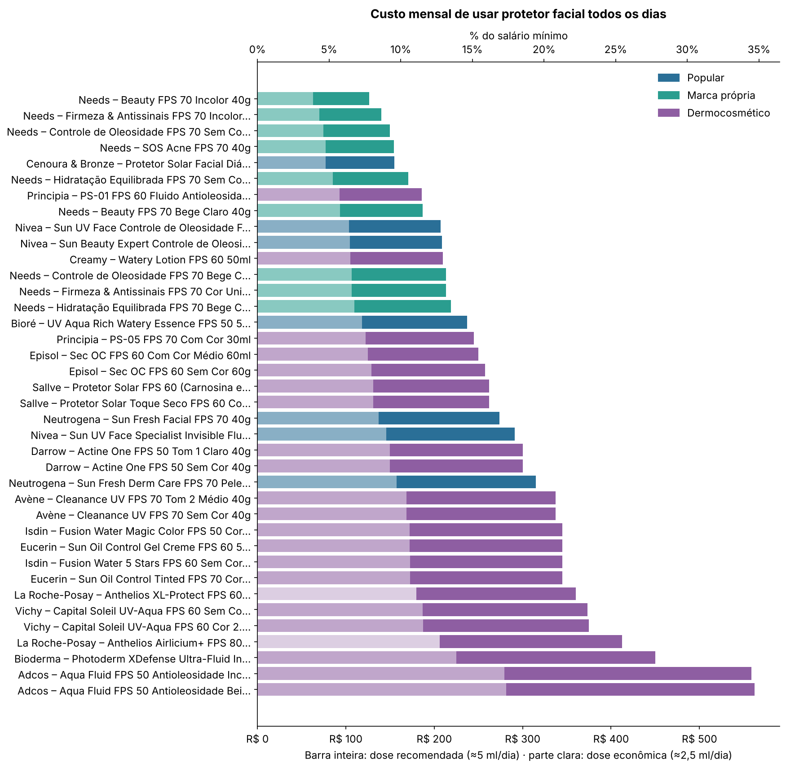
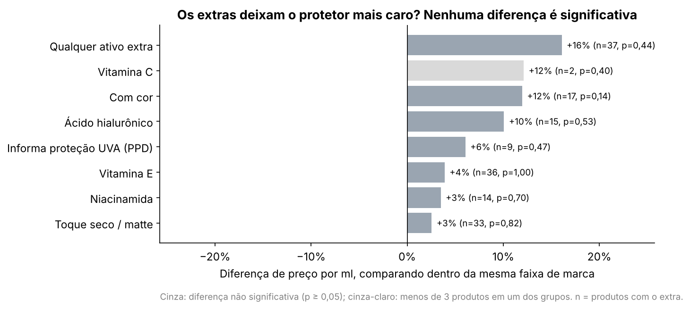
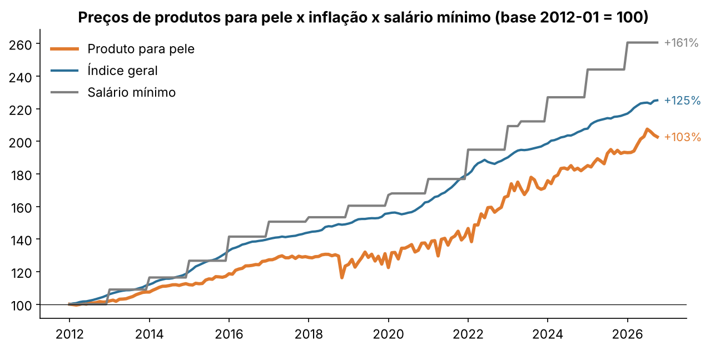
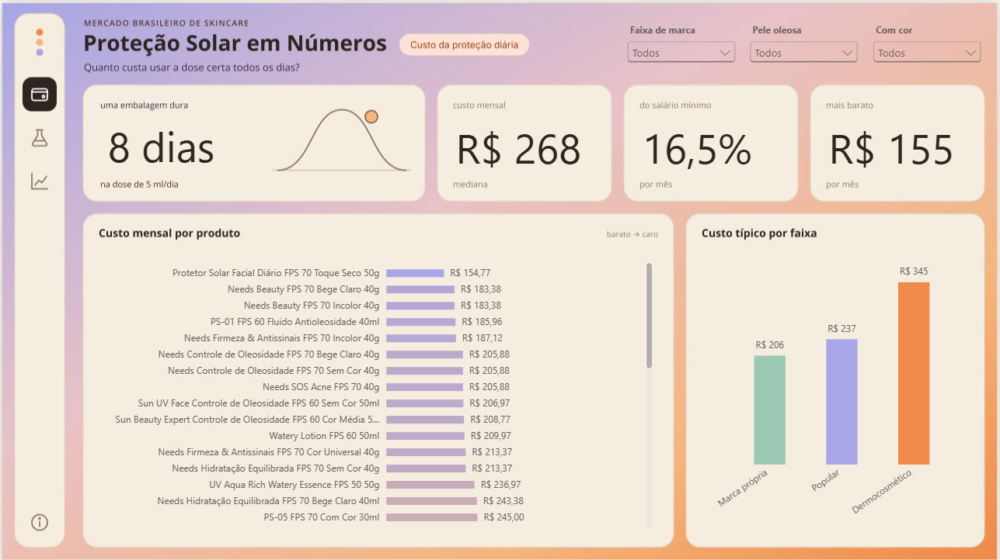
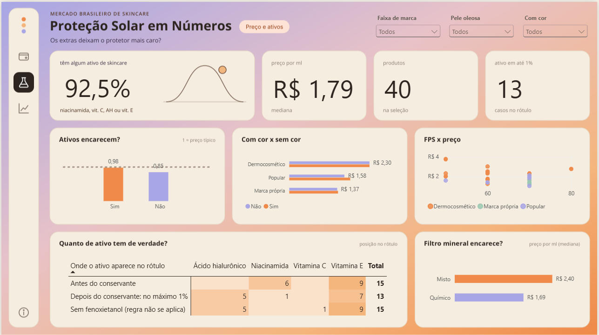
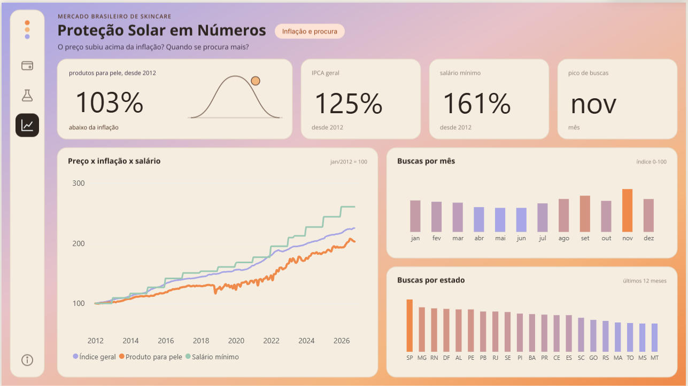

# Cuidar da pele no Brasil cabe no bolso?

Preço, acesso e procura por **protetor solar facial** no mercado brasileiro, com dados 100% reais: levantamento próprio de preços, IPCA (IBGE), salário mínimo e Google Trends.

  

## Problema

A Sociedade Brasileira de Dermatologia recomenda usar protetor solar **todos os dias**, na quantidade de uma colher de chá para rosto, cabeça e pescoço. Num país tropical, é um cuidado de saúde básico. Mas quanto custa seguir essa recomendação, e quem tem pele oleosa, muito comum no clima brasileiro, encontra uma opção que caiba no orçamento?

**Perguntas:**
1. Quanto custa proteger o rosto e como o preço varia entre marcas populares, dermocosméticas e marcas próprias de farmácia?
2. Quanto o uso diário custa por mês e quanto isso representa do salário mínimo?
3. Há opções acessíveis para pele oleosa?
4. Ativos como niacinamida e vitamina C, cor ou toque seco deixam o protetor mais caro?
5. Quando e onde o brasileiro mais procura protetor facial? E os produtos para pele ficaram mais caros que a inflação?

## Principais resultados

- **Custo mensal:** usar protetor facial todos os dias, na dose recomendada, custa em mediana **R$ 237 por mês** numa marca popular e **R$ 345** num dermocosmético, ou **14,6% e 21,3% do salário mínimo**. Nenhum dos 40 produtos fica abaixo de 5% do salário mínimo; o mais barato (Cenoura & Bronze) custa **R$ 155 por mês** (9,5%). Na marca própria Needs, a mediana é R$ 206 por mês (12,7%).
- **A embalagem acaba rápido:** na dose correta, uma embalagem dura **8 dias** (mediana).
- **Pele oleosa:** **34 dos 40** produtos são indicados para pele oleosa ou têm toque seco, e **11** deles são populares ou de marca própria. Opção existe; o problema é o custo da dose correta.
- **Extras:** dentro da mesma faixa, protetores com niacinamida, ácido hialurônico ou vitamina E custam de **3% a 10% a mais** por ml, mas **nenhuma diferença é estatisticamente significativa** (teste de Mann-Whitney, p ≥ 0,59). Somando os quatro ativos, quem tem algum custa 16% a mais, também sem significância (p = 0,47; só 3 produtos não têm nenhum). Com 92% dos produtos trazendo algum ativo extra, isso virou padrão do mercado, não diferencial de preço.
- **Filtro mineral:** protetores com filtro misto (químico + dióxido de titânio) custam **R$ 2,40 por ml**, contra **R$ 1,69** dos só químicos. Dentro da mesma faixa de marca a diferença é de **28%** (p = 0,002), o único extra com diferença estatisticamente significativa. Mas os 9 produtos mistos vêm de só 5 linhas de 4 marcas, então é um indício a confirmar com mais produtos.
- **Dose dos ativos:** em **13 de 28** casos, o ativo aparece no rótulo depois do conservante, ou seja, em no máximo 1%.
- **Com cor:** nos 15 pares da mesma linha, a versão com cor tem **o mesmo preço por ml** da sem cor (diferença mediana de 0%). As exceções são duas linhas da Needs (Hidratação Equilibrada e Firmeza & Antissinais) e a Neutrogena, em que a versão com cor custa de 14% a 15% a mais.
- **Inflação:** desde 2012, os produtos para pele subiram **103%**, menos que o IPCA geral (**125%**) e o salário mínimo (**161%**). O protetor não ficou mais caro em termos reais: ele pesa no bolso porque a dose correta consome muito produto.
- **Procura:** o interesse de busca chega ao pico em **novembro**, antes do verão, e é **1,8 vez maior** que em **maio**, o mês mais fraco. São Paulo e Minas Gerais lideram as buscas; Rio Grande do Norte, Distrito Federal e Pernambuco vêm logo atrás, praticamente empatados.

*Coleta de preços de 24 a 26/11/2026 (preço cheio da Needs conferido em 26/11). Google Trends baixado em 25/11/2026.*







## Dashboard no Power BI

O arquivo `powerbi/protetor_solar.pbix` resume os resultados em quatro páginas, com filtros por faixa de marca, pele oleosa e versão com cor (os filtros valem nas duas primeiras páginas).

| Página | Pergunta | O que mostra |
|---|---|---|
| **Custo** | Quanto custa usar a dose certa todos os dias? | Quantos dias dura uma embalagem, custo mensal mediano, peso no salário mínimo, opção mais barata, ranking de custo por produto e custo típico por faixa |
| **Preço e ativos** | Os extras deixam o protetor mais caro? | Quantos produtos têm ativo extra, preço relativo de quem tem e quem não tem, com cor x sem cor, FPS x preço, a ordem dos ativos no rótulo e o preço do filtro mineral |
| **Inflação e procura** | O preço subiu acima da inflação? Quando se procura mais? | Alta acumulada de produtos para pele, IPCA e salário mínimo desde 2012, buscas por mês do ano e os 20 estados com mais interesse |
| **Sobre os dados** | De onde vêm os números? | Fontes, método de cálculo e limitações |







### Como ler o dashboard

**Custo.** Todo custo é calculado na dose recomendada (≈5 ml por dia, 30 dias por mês) e com o preço cheio, sem desconto. "Mediana" é o valor do meio: metade dos produtos custa menos e metade custa mais.

**Ativos encarecem?** Cada produto é comparado com o preço típico da sua própria faixa de marca. **1 = preço típico da faixa**: 0,98 quer dizer 2% abaixo do típico. A linha tracejada marca o 1. Assim, "ter niacinamida" não se confunde com "ser dermocosmético".

**Quanto de ativo tem de verdade?** A tabela usa duas regras da rotulagem de cosméticos para estimar se o ativo aparece em quantidade relevante:

1. Ingredientes com **mais de 1%** vêm em **ordem decrescente** no rótulo; os que têm **1% ou menos** podem vir em qualquer ordem, no final.
2. O **fenoxietanol**, conservante mais comum, só pode ser usado **até 1%**.

Logo, um ativo que aparece **depois** do fenoxietanol está em **no máximo 1%**.

- **Cada número é um caso:** um ativo encontrado em um produto. Um protetor com niacinamida e vitamina E conta duas vezes, uma em cada coluna. Só entram os **28 produtos com lista de ingredientes conferida** (43 casos ao todo).
- **Célula vazia = nenhum caso.** Por exemplo, nenhum produto tem ácido hialurônico antes do conservante.
- **Antes do conservante (15):** o ativo *pode* estar acima de 1%, mas isso não é garantido, porque abaixo de 1% a ordem é livre.
- **Depois do conservante (13):** o ativo está em **no máximo 1%**. É o número do cartão "ativo em até 1%".
- **Sem fenoxietanol (15):** a fórmula não usa esse conservante, então a regra não se aplica e não dá para estimar a quantidade.
- **Como interpretar:** nos 28 casos em que a regra se aplica (15 + 13), quase metade (13) tem o ativo em no máximo 1%. Estar no rótulo não garante estar em quantidade relevante. A vitamina E é a mais comum porque muitas vezes entra como antioxidante para proteger a própria fórmula, e não como ativo de skincare.

**Filtro mineral encarece?** "Misto" são os protetores que combinam filtros químicos com dióxido de titânio (filtro mineral); "químico" são os que só têm filtros químicos. Os 3 produtos sem tipo de filtro informado ficam de fora.

**Buscas.** O Google Trends não mostra quantas buscas houve, e sim um índice de 0 a 100 em que 100 é o mês (ou o estado) de maior interesse. As comparações são sempre relativas.

## Recomendações

1. **Marcas e varejo:** embalagens maiores ou refis com menor preço por ml, já que na dose correta uma embalagem dura pouco mais de uma semana.
2. **Farmácias:** marcas próprias de toque seco para atender pele oleosa a preço acessível.
3. **Campanhas:** reforçar estoque e comunicação nos meses e estados de maior procura, mantendo a mensagem de uso o ano inteiro.
4. **Consumidor:** comparar pelo custo mensal, e não só pelo preço da embalagem.

## Dados

| Fonte | O que é | Arquivo |
|---|---|---|
| Levantamento próprio | 40 protetores faciais coletados em 24 e 25/11/2026 (preço cheio da Needs conferido em 26/11): 23 sem cor (18 marcas + 5 linhas da marca própria Needs) e 17 versões com cor: preço cheio, preço promocional, tamanho, FPS, tipo de pele, acabamento, ativos e tipo de filtro pela lista de ingredientes do site oficial da marca, proteção UVA, com link de cada produto | `data/coleta_protetores.xlsx` |
| IBGE – IPCA (SIDRA, tabelas 1419 e 7060) | variação mensal do subitem "Produto para pele" e do índice geral | baixado pelo notebook |
| Salário mínimo | valores oficiais por decreto, 2012 a 2026 | no notebook |
| Google Trends | interesse de busca no Brasil por semana (5 anos) e por estado (12 meses) | `data/trends_tempo.csv`, `data/trends_estados.csv` |

## Método

1. **Coleta:** a coleta foi feita na semana da Black Friday, então o preço usado é o **cheio**: o valor "De" da Drogaria São Paulo (quando o "De" aparece zerado, o "Por" já é o preço cheio). O preço com desconto fica numa coluna separada. A Needs só é vendida na Raia/Drogasil. Ali a coleta de 24 e 25/11 pegou preços de Black Friday, então o preço cheio foi conferido no valor "De" riscado da Drogasil em 26/11/2026, e o preço da coleta ficou na coluna de preço promocional. Duas exceções: a Sallve, esgotada na DSP, entrou com o preço do site da marca, e a Principia PS-05, que a DSP não vende, com o preço sugerido pela marca. Só anúncios vendidos pela própria loja (sem marketplace). A leitura das páginas foi feita com apoio de IA e conferida manualmente por amostragem.
2. **Preço por ml:** permite comparar embalagens de tamanhos diferentes.
3. **Custo mensal:** preço por ml × quantidade por aplicação × 30 dias, em dois cenários. O **recomendado** usa 1 colher de chá (≈5 ml), conforme a regra da SBD para rosto, cabeça e pescoço. O **econômico** usa meia colher (≈2,5 ml).
4. **Extras:** ativos (niacinamida, vitamina C, ácido hialurônico, vitamina E) marcados quando aparecem na lista de ingredientes (INCI) do site oficial da marca; quando o site não mostra a lista, a fonte usada está na coluna Observações. Cada produto é comparado com a mediana da sua faixa de marca, para não confundir "ter o ativo" com "ser dermocosmético". A diferença usa a média geométrica do preço relativo à faixa, e o teste de Mann-Whitney indica se ela pode ser só acaso.
5. **Dose dos ativos pela ordem do rótulo:** acima de 1% os ingredientes vêm em ordem decrescente, e o fenoxietanol (conservante) só pode ser usado até 1%. Um ativo listado depois dele está, portanto, em no máximo 1%. Ideia de Henrique.
6. **Com cor x sem cor:** para cada linha com as duas versões, comparo o preço por ml.
7. **Inflação:** IPCA mensal acumulado, comparado com o reajuste do salário mínimo no mesmo período.
8. **Buscas:** sazonalidade (média do índice por mês do ano) e ranking de estados.

## Limitações

- O levantamento é uma amostra de produtos e preços de três dias (24 a 26/11/2026) e de quatro fontes de preço: Drogaria São Paulo (29 produtos), Drogasil (9, todos da Needs), site da Sallve (1) e preço sugerido da Principia (1).
- O preço cheio da Needs foi conferido em 26/11/2026, um ou dois dias depois do resto da coleta. Da Needs entram só as 5 linhas faciais principais.
- Protetores em bastão têm preço por g bem maior que os fluidos.
- A dose por aplicação é uma aproximação. A regra da colher de chá vale para rosto, cabeça e pescoço juntos; só para o rosto, a dose seria menor, mais perto do cenário econômico. A reaplicação ao longo do dia não entrou na conta.
- A faixa da marca é uma classificação minha. Sallve, Principia e Creamy entraram como dermocosmético, embora tenham preço mais perto das marcas populares; isso puxa para baixo a mediana dessa faixa.
- O Google Trends mostra interesse relativo (0 a 100), não o número de buscas.
- Produtos vendidos em gramas foram tratados como 1 g ≈ 1 ml.
- Nem toda lista de ingredientes está disponível: a Needs não publica a lista completa e alguns sites mostram só a da versão sem cor. Nesses casos os ativos vêm da descrição ou da versão sem cor, anotado na coluna "Fonte da lista". A regra da ordem do rótulo dá só um teto (no máximo 1%), não a concentração exata. Ainda falta conferir no rótulo as listas do Needs Beauty Incolor (traz óxidos de ferro, como as versões com cor), do Bioderma (lista da versão europeia) e do Episol com cor.
- Marca própria representada só pela Needs (rede Raia/Drogasil).

## Próximos passos

- [x] Dashboard no Power BI
- [ ] Completar as listas da Needs pelo rótulo e analisar filtros mais usados e ingredientes em comum entre marcas caras e baratas
- [ ] Repetir a coleta em outras lojas e datas
- [ ] Incluir renda por região (PNAD Contínua)
- [ ] Cruzar a procura com índice UV e temperatura por estado (INMET)

## Como reproduzir

```bash
git clone https://github.com/Chofss99/protetor-solar-brasil.git
cd protetor-solar-brasil
pip install -r requirements.txt
```

Abra `notebooks/analise_protetor_solar.ipynb` e rode todas as células. Na primeira execução, o notebook baixa o IPCA da API do IBGE e salva uma cópia em `data/`. Para atualizar os dados, veja `data/COMO_BAIXAR_OS_DADOS.md`.

Para o dashboard, abra `powerbi/protetor_solar.pbix` no Power BI Desktop. Se o arquivo de dados estiver em outra pasta, aponte para `powerbi/dados_powerbi.xlsx` em **Página inicial → Transformar dados → Configurações da fonte de dados** e clique em **Atualizar**.

## Estrutura

```
├── data/          # levantamento de preços, Google Trends e cópia do IPCA
├── images/        # gráficos do notebook e prints do dashboard
├── notebooks/
│   └── analise_protetor_solar.ipynb
├── powerbi/       # dashboard (.pbix) e base de dados do Power BI
└── requirements.txt
```

## Contato

**Giovana Lauriano Cenerini** · Estudante de Ciência de Dados (FIAP) · Campinas, SP
[LinkedIn](https://www.linkedin.com/in/giovana-lauriano-cenerini-030410199/) 
